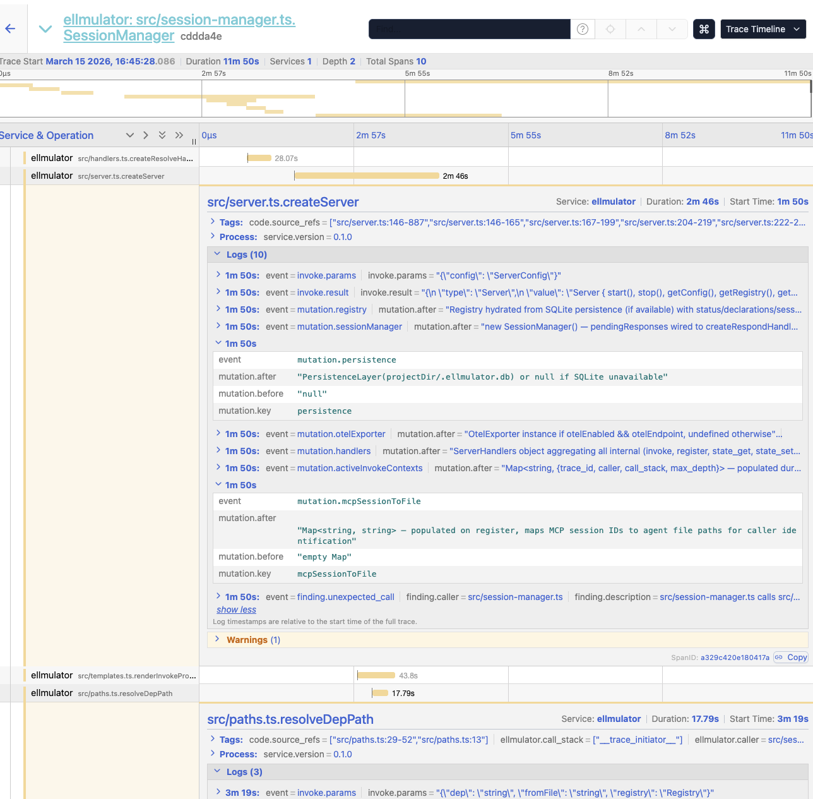

# eLLMulator

**Agentic Distributed Trace Simulation — LLM agents as software components.**

Traditional distributed tracing shows *what* happened at runtime. It can't reason about intent, surface contract mismatches between modules, or detect assumption bugs hidden in code. You need to actually run the system with instrumentation — expensive, and it still misses logical and architectural issues.

eLLMulator takes a different approach: LLM agents *become* your software components. Each agent deeply studies its assigned source file, then interacts with other agents via synchronous MCP tool calls that mirror real function calls. The call graph emerges naturally from code control flow, producing traces that capture not just what happened, but *why* each component behaved as it did.

**The core insight:** MCP tool calls are synchronous from the caller's perspective — that *is* the invoke primitive. No custom agent framework needed. The [Claude Agent SDK](https://www.npmjs.com/package/@anthropic-ai/claude-agent-sdk) provides sessions, MCP provides the bus. The code itself is the routing layer.


---

## Features

- **Five finding types** — contract mismatches, assumption bugs, missing error paths, dead spots, unexpected calls
- **Three trace modes** — full (recursive), targeted (selective dependencies), lens (entry-point-only with stubs)
- **Multi-layer guardrails** — cycle detection, depth limiting, rate limiting, self-loop protection, circuit breaker
- **Smart entry point detection** — LLM-powered resolution from natural language scenarios
- **Dependency graph (Starmap)** — import extraction, SCC clustering, cross-boundary edge detection
- **LLM-enriched summaries** — post-trace analysis with architectural observations
- **SQLite persistence** — WAL-mode durable storage for registry and trace log
- **Bounded concurrency** — configurable thread pool for parallel agent bootstrap
- **Consolidation** — detect file changes, mark stale agents, optional re-bootstrap
- **OpenTelemetry export** — fire-and-forget OTLP span export to any collector (Jaeger, Tempo, Honeycomb)
- **Project onboarding** — `ellmulator init` idempotently wires MCP, permissions, and docs into any project
- **Dual MCP surface** — external tools for users, internal tools for agent-to-agent communication

## Next Steps

- **More Agent Frameworks** - to support opencode, codex, and other popular suites
- **Smaller Agents Support** - optimize further the speed of the tracing
- **eLLMulator Skill** - so agents can make advanced and efficient testing and troubleshooting

## Architecture

```
┌────────────────────────────────────────────────────────────────┐
│                         eLLMulator                             │
│                                                                │
│  ┌──────────────────────────┐   ┌───────────────────────────┐  │
│  │   External MCP :3100     │   │    Internal MCP :3101     │  │
│  │                          │   │                           │  │
│  │   • trace                │   │    • invoke               │  │
│  │   • inspect              │   │    • register             │  │
│  │   • status               │   │    • state_get/state_set  │  │
│  │   • list_agents          │   │    • resolve              │  │
│  │   • consolidate          │   │    • respond              │  │
│  │   • starmap              │   │                           │  │
│  └────────────┬─────────────┘   └─────────────┬─────────────┘  │
│               │                               │                │
│  ┌────────────▼───────────────────────────────▼─────────────┐  │
│  │                      Server Core                         │  │
│  │                                                          │  │
│  │  ┌──────────┐  ┌──────────┐  ┌──────────┐  ┌─────────┐   │  │
│  │  │ Registry │  │ Sessions │  │ TraceLog │  │ Starmap │   │  │
│  │  └──────────┘  └──────────┘  └──────────┘  └─────────┘   │  │
│  │                                                          │  │
│  │  ┌────────────────────────────────────────────────────┐  │  │
│  │  │              Agent Pool (per-file)                 │  │  │
│  │  │                                                    │  │  │
│  │  │  ┌───────┐ ┌───────┐ ┌──────┐ ┌──────┐ ┌──────┐    │  │  │
│  │  │  │api.ts │ │svc.ts │ │db.ts │ │ auth │ │ util │    │  │  │
│  │  │  └───────┘ └───────┘ └──────┘ └──────┘ └──────┘    │  │  │
│  │  │       Each agent = Claude SDK session              │  │  │
│  │  └────────────────────────────────────────────────────┘  │  │
│  └──────────────────────────────────────────────────────────┘  │
└────────────────────────────────────────────────────────────────┘
```

- **External MCP** (`:3100`) — consumed by users, CLI, or MCP clients like Claude Code
- **Internal MCP** (`:3101`) — consumed by file agents for inter-agent communication
- **Agent Pool** — one Claude SDK session per source file, lazy-spawned on first invoke

## Quick Start

```bash
# Install
git clone https://github.com/fblgit/eLLMulator.git
cd eLLMulator
npm install
npm run build

# Configure
echo "ANTHROPIC_API_KEY=sk-ant-..." > .env

# Init the eLLMulator (Setup the mcp configuration and prompt)
npx ellmulator init /path/to/your/app

# Bootstrap + start server
npx ellmulator start --project /path/to/your/app --bootstrap

# Run a trace (in another terminal)
npx ellmulator trace "What happens when a user submits an order?" \
  --entry src/api.ts \
  --output trace.jsonl
```

> 📖 See **[QUICKSTART.md](./QUICKSTART.md)** for a detailed step-by-step guide.
 
## How It Works

### 1. Scan

The scanner walks your project directory, collecting source files by extension while skipping configured directories (node_modules, .git, etc.) and test files. Each file gets a SHA256 hash for change detection.

### 2. Bootstrap

Every scanned file is registered as `cold` in the registry. Then, with bounded concurrency (default: 10 threads), each file gets its own Claude SDK session. The agent receives a system prompt containing:

- Its identity ("You are `src/api.ts`")
- The full source code of its file
- Source code of direct dependencies
- A registry map showing all other files and their status
- Boundary routing info (same-cluster vs cross-boundary)

The agent analyzes its source code and calls `register()` to declare its symbols (functions, classes, types), dependencies, and a summary.

### 3. Trace

When you run a trace with a scenario like *"What happens when a user submits an order?"*:

1. The server resolves the entry point (from `--entry` flag or via LLM-powered detection)
2. Builds an `InvokeEnvelope` and calls `invoke()` on the entry agent
3. The agent receives a structured prompt with the scenario, parameters, and call stack
4. The agent reasons about its code's behavior and may `invoke()` other agents (its dependencies)
5. Each agent responds via `respond()` with return values, mutations, and `source_refs` (file:line evidence)
6. The recursive call graph builds naturally — exactly as the real code would execute

Guardrails prevent runaway traces: cycle detection, depth limits, rate limits, self-loop protection, and circuit breakers.

### 4. Analyze

After the trace completes, five analyzers examine the trace entries:

| Analyzer | Detects |
|----------|---------|
| **Contract Mismatch** | Calls to functions not declared by the target |
| **Dead Spot** | Registered files never referenced in the trace |
| **Unexpected Call** | Calls to targets not in the caller's declared dependencies |
| **Missing Error Path** | Error responses with no caller error handling |
| **Assumption Bug** | Mismatches between `expected_output` and actual results |

The `TraceResult` includes all entries, findings, an LLM-enriched summary, and duration. Or via OTEL with your usual distributed tracing suite, like Jaeger:



## CLI Reference

### `ellmulator start`

Start the server with optional bootstrap.

| Flag | Default | Description |
|------|---------|-------------|
| `--project <dir>` | *(required)* | Path to the target project |
| `--bootstrap` | `false` | Scan and bootstrap all files on startup |
| `--ext-port <n>` | `3100` | External MCP port |
| `--int-port <n>` | `3101` | Internal MCP port |
| `--threads <n>` | `10` | Concurrent bootstrap sessions |
| `--model <name>` | `claude-opus-4-6` | Claude model for agent sessions |
| `--extensions <list>` | `.ts,.go,.py` | Comma-separated file extensions to scan |
| `--skip-dirs <list>` | `.git,node_modules,vendor` | Comma-separated directories to skip |
| `--verbose` | `false` | Enable verbose logging |
| `--otel-endpoint <url>` | *(none)* | OTLP collector endpoint — enables OTEL export |
| `--otel-protocol <proto>` | `http/protobuf` | Wire protocol: `http/protobuf` or `http/json` |
| `--no-otel` | — | Disable OTEL export even if endpoint is configured |

```bash
ellmulator start --project ./my-app --bootstrap --threads 5 --model claude-sonnet-4-5-20250514

# With OpenTelemetry export to Jaeger
ellmulator start --project ./my-app --bootstrap \
  --otel-endpoint http://localhost:4318/v1/traces
```

### `ellmulator trace`

Run a trace scenario against a running server (or start one inline).

| Flag | Default | Description |
|------|---------|-------------|
| `<scenario>` | *(positional)* | Natural language scenario description |
| `--entry <file>` | *(auto-detect)* | Entry point file path |
| `--max-depth <n>` | `50` | Maximum call stack depth |
| `--output <file>` | *(none)* | Write trace log as JSONL to file |
| `--state <json>` | *(none)* | Initial synthetic state (JSON string) |
| `--otel-endpoint <url>` | *(none)* | OTLP collector endpoint for this trace |
| `--otel-protocol <proto>` | `http/protobuf` | Wire protocol: `http/protobuf` or `http/json` |

```bash
ellmulator trace "Process a payment for order ORD-123" \
  --entry src/payments/handler.ts \
  --max-depth 20 \
  --output payment-trace.jsonl \
  --state '{"userId": "user-42"}'
```

### `ellmulator init`

Initialize a project to use eLLMulator. Idempotently configures MCP connection, tool permissions, and documentation.

| Flag | Default | Description |
|------|---------|-------------|
| `<target-dir>` | *(required)* | Path to the project to onboard |
| `--ext-port <n>` | `3100` | eLLMulator external MCP port |

```bash
ellmulator init ./my-project
ellmulator init ./my-project --ext-port 4200
```

Creates/updates three files in the target project:
- `.mcp.json` — adds `ellmulator` MCP server entry
- `.claude/settings.local.json` — adds tool permissions and enables the MCP server
- `CLAUDE.md` — appends eLLMulator usage section

Safe to re-run: merges without clobbering existing config, skips entries already present.

### `ellmulator consolidate`

> Requires a running server. Connect via MCP client.

Rescans the project, detects changed files (by hash), marks them stale, and optionally re-bootstraps.

### `ellmulator status`

> Requires a running server. Connect via MCP client.

Returns server statistics: total files, status breakdown, active traces, agent pool size.

## MCP Tool Reference

### External Tools (port 3100)

These are the tools exposed to users and MCP clients.

| Tool | Description |
|------|-------------|
| `trace` | Start a trace scenario. Params: `entry_file`, `function`, `params?`, `mode?`, `max_depth?`, `expected_output?` |
| `inspect` | Get agent declarations for a file. Params: `file_path` |
| `status` | Server statistics: file counts by status, active traces, pool size |
| `list_agents` | List registered agents with optional status filter |
| `consolidate` | Rescan project, detect changes, optional re-bootstrap |
| `starmap` | Generate dependency graph |

### Internal Tools (port 3101)

These are used by file agents during traces.

| Tool | Description |
|------|-------------|
| `invoke` | Call a function on another file agent (full `InvokeEnvelope`) |
| `register` | Register declarations (symbols, dependencies, summary) |
| `state_get` | Read synthetic state by key |
| `state_set` | Write synthetic state by key |
| `resolve` | Look up another file's declarations |
| `respond` | Submit a `ResponseEnvelope` (returns, mutations, source_refs) |

## Trace Modes

### Full (default)

Recursively invokes all agents along the call path. The complete call graph is explored depth-first. Best for comprehensive analysis.

```bash
ellmulator trace "Handle user login" --entry src/auth.ts
```

### Targeted

Invokes the entry point and selectively follows dependencies. Use `targetPath` to specify which files to include, or let the scenario description guide filtering.

### Lens

Invokes only the entry point agent. All dependencies are stubbed with synthetic trace entries. Fast and focused — useful for analyzing a single file's behavior in isolation.

## Finding Types

### `contract_mismatch` (severity: high)

A file agent called a function that doesn't exist in the target's declared symbols. Indicates an interface contract violation — the caller assumes an API that the target doesn't provide.

### `assumption_bug` (severity: medium–high)

The caller's `expected_output` doesn't match the actual result. For example, a service expects `queryUser()` to return `{id, name, email}` but the database layer returns `{id, name}`. Also triggers when a call returns an error when success was expected.

### `missing_error_path` (severity: medium)

A dependency returned an error, but the caller has no error handling for that call path. The error silently propagates or is ignored.

### `dead_spot` (severity: medium)

A file is registered in the system but never referenced in any trace — neither as a caller nor a target. May indicate dead code, or simply that the trace scenario didn't exercise that path.

### `unexpected_call` (severity: low–medium)

A file agent called a target that isn't in its declared dependencies. May indicate an undeclared import or an implicit coupling.

## Configuration

### Environment Variables

Create a `.env` file in the project root:

```bash
# Required — your Anthropic API key
ANTHROPIC_API_KEY=sk-ant-...
```

### Ports

- External MCP: `3100` (override with `--ext-port`)
- Internal MCP: `3101` (override with `--int-port`)

Both bind to `127.0.0.1` (localhost only).

### Model Selection

Default model is `claude-opus-4-6`. Override with `--model`:

```bash
ellmulator start --project ./app --model claude-sonnet-4-5-20250514
```

### File Filtering

Control which files are scanned:

```bash
# Only TypeScript and Python
ellmulator start --project ./app --extensions .ts,.py

# Skip additional directories
ellmulator start --project ./app --skip-dirs .git,node_modules,vendor,generated
```

Test files (`*.test.*`, `*.spec.*`, `*.d.ts`) are always excluded from scanning.

## Development

### Prerequisites

- Node.js ≥ 22
- An Anthropic API key with access to Claude models
- TypeScript 5.7+

### Commands

```bash
# Install dependencies
npm install

# Build TypeScript → dist/
npm run build

# Run all tests
npm test

# Run tests in watch mode
npx vitest

# Run a single test file
npx vitest run src/analyzer.test.ts

# Run integration tests (requires API key)
RUN_INTEGRATION=1 npx vitest run src/__integration__/e2e.test.ts
```

### Project Structure

```
src/
├── types.ts              # Shared types (InvokeEnvelope, TraceEntry, Finding, etc.)
├── cli.ts                # CLI argument parsing and command dispatch
├── server.ts             # Main server — creates both MCP surfaces, wires handlers
├── invoke.ts             # Core invoke handler — guardrails, spawn, SDK query, trace log
├── registry.ts           # File registry — CRUD for RegistryEntry
├── scanner.ts            # Project file scanner — walk, hash, filter
├── session-manager.ts    # Claude SDK session lifecycle
├── bootstrap.ts          # Bootstrap flow — scan → register → concurrent spawn
├── consolidate-flow.ts   # Consolidation — rescan, detect stale, re-bootstrap
├── analyzer.ts           # Post-trace analysis — 5 sub-analyzers + summary
├── starmap.ts            # Dependency graph — import extraction, SCC, clustering
├── guardrails.ts         # Safety checks — cycle, depth, rate, self-loop, circuit breaker
├── handlers.ts           # Internal MCP tool handler factories
├── mcp-external.ts       # External MCP tool handler factories
├── templates.ts          # Prompt rendering — system, bootstrap, invoke
├── schemas.ts            # Zod schemas for all 12 MCP tool inputs
├── otel-export.ts        # OpenTelemetry span conversion and OTLP export
├── init.ts               # Project onboarding — `ellmulator init` upsert operations
├── persistence.ts        # SQLite persistence layer (WAL mode)
├── trace-log.ts          # In-memory trace log with JSONL export
├── __behavioral__/       # Behavioral test suites (phase-organized)
└── __integration__/      # E2E integration tests
```

### Test Organization

- **Unit tests**: co-located as `foo.test.ts` next to `foo.ts`
- **Behavioral tests**: `src/__behavioral__/` — organized by implementation phase
- **Integration tests**: `src/__integration__/` — full pipeline E2E, gated behind `RUN_INTEGRATION=1`

### Design Principles

- **Dependency injection everywhere** — all handlers take deps objects, no globals
- **Factory pattern** — `createXHandler(deps)` returns handler functions
- **Types in `types.ts`** — single source of truth, re-exported for backward compatibility
- **`type` for data shapes, `interface` for behavioral contracts**
- **Zod for runtime validation** — all MCP tool inputs validated via schemas

## Using with Claude Code

Initialize your project with one command:

```bash
ellmulator init ./my-project
```

This configures `.mcp.json`, `.claude/settings.local.json`, and `CLAUDE.md` automatically. Then start the server and Claude Code can use the `trace`, `inspect`, `status`, `list_agents`, `consolidate`, and `starmap` tools directly.

See **[QUICKSTART.md](./QUICKSTART.md)** section 8 for the full walkthrough.

## Contributing

1. Fork the repository
2. Create a feature branch (`git checkout -b feature/my-feature`)
3. Write tests first (RED), then implement (GREEN), then refactor
4. Ensure all tests pass: `npm test`
5. Ensure TypeScript compiles: `npm run build`
6. Submit a pull request

## Citation
Rember to cite the author if you get inspired and motivated by this concept:
```
@misc{eLLMulator,
  author = {Xavier Murias},
  title = {eLLMulator: Agentic Distributed Trace Simulation — LLM agents as software components},
  year = {2026},
  publisher = {GitHub},
  journal = {GitHub repository},
  howpublished = {\url{https://github.com/fblgit/eLLMulator}},
}
```
