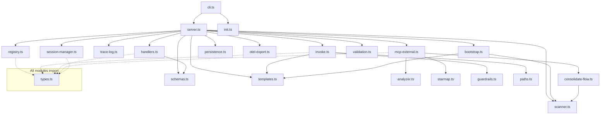
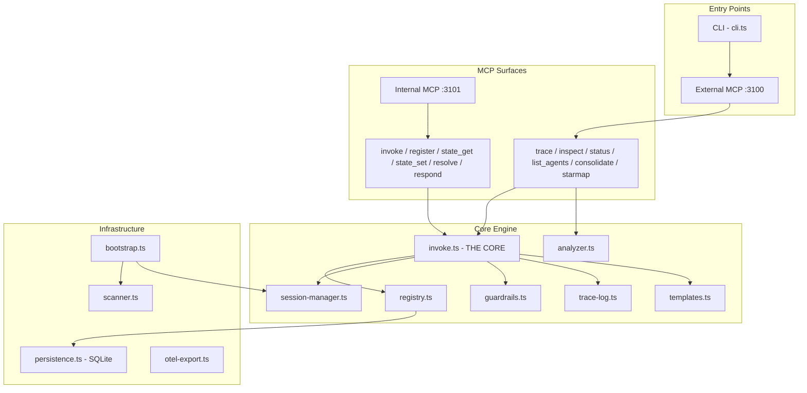

# System Architecture

eLLMulator is a dual-MCP-surface server where LLM agents (Claude SDK sessions) impersonate source code files. Agents study their assigned file, register declarations, then communicate via synchronous MCP tool calls that mirror real function invocations. The call graph emerges naturally from code control flow, capturing not just what happened but WHY each component behaved as it did.

## Dual MCP Surface

Two HTTP MCP servers run on separate ports, each with distinct audiences:

| Surface | Default Port | Audience | Tools |
|---------|-------------|----------|-------|
| **External** | 3100 | Users, CLI, MCP clients | `trace`, `inspect`, `status`, `list_agents`, `consolidate`, `starmap` |
| **Internal** | 3101 | File agents (SDK sessions) | `invoke`, `register`, `state_get`, `state_set`, `resolve`, `respond` |

Each client/agent gets its own `StreamableHTTPServerTransport` + `McpServer` pair (per-session factory pattern). This is necessary because the MCP SDK transport is single-session, so concurrent agents need independent pairs.

## Module Dependency Map



## Layer Diagram



## Server Composition

`createServer(config: ServerConfig)` in `src/server.ts` is the main factory. It:

1. **Resolves config** — applies defaults (ports 3100/3101, model `claude-sonnet-4-6`)
2. **Creates shared state:**
   - `Registry` — in-memory Map for file→agent mappings
   - `SessionManager` — SDK session lifecycle wrapper
   - `TraceLog` — trace entry collection
   - `SyntheticState` — shared key-value store for agents
   - `RateLimitTracker` / `SelfLoopTracker` — guardrail counters
3. **Opens persistence** — SQLite WAL-mode database, hydrates registry from disk
4. **Creates OTEL exporter** — error-isolated, fire-and-forget
5. **Wires handler factories** — each handler closes over its deps:
   - `createRegisterHandler(registry)`
   - `createStateHandlers(syntheticState)`
   - `createResolveHandler(registry, readFile)`
   - `createRespondHandler(pendingResponses)`
   - `createTraceHandler(traceDeps)`
   - `createInspectHandler(queryDeps)`
   - `createStatusHandler(queryDeps)`
   - `createListAgentsHandler(queryDeps)`
   - `createConsolidateHandler(consolidateDeps)`
6. **Starts HTTP servers** — binds both MCP surfaces with per-session transport factories

### Per-Session MCP Transport

When a new MCP session connects (agent during bootstrap, or external client):

```
HTTP POST /mcp → session factory → new McpServer + StreamableHTTPServerTransport
                                   ↓
                                   Register all tools for that surface
                                   ↓
                                   mcpSessionToFile[session_id] = agent_file_path
```

Two key maps bridge MCP sessions to trace context:

- **`mcpSessionToFile`** — `Map<mcp_session_id, file_path>` — identifies which agent is making a tool call
- **`activeInvokeContexts`** — `Map<task_id, {trace_id, caller, call_stack, max_depth}>` — auto-fills envelope fields when agents use the simplified `AgentInvokeInputSchema`

## Key Files

| File | Lines | Role |
|------|-------|------|
| `src/server.ts` | ~920 | Main entry, creates both MCP surfaces, wires handlers |
| `src/invoke.ts` | ~630 | THE CORE — guardrails, lazy spawn, SDK query, trace log |
| `src/session-manager.ts` | ~576 | SDK wrapper — create, rehydrate, invokeOnSession, terminate |
| `src/registry.ts` | ~103 | File→session→status mapping with state machine validation |
| `src/guardrails.ts` | ~151 | Safety: cycle, depth, rate-limit, self-loop, circuit breaker |
| `src/handlers.ts` | ~214 | Internal MCP handlers: register, state, resolve, respond |
| `src/mcp-external.ts` | ~200+ | External MCP handlers: trace, inspect, status, consolidate |
| `src/templates.ts` | ~150+ | Prompt rendering: system, bootstrap, invoke |
| `src/analyzer.ts` | ~860 | Post-trace analysis: 5 finding types + entry point detection |
| `src/bootstrap.ts` | ~150+ | Scan → bulk register → concurrent spawn |
| `src/types.ts` | ~170 | All shared type definitions |
| `src/schemas.ts` | ~239 | Zod validation schemas for all 12 MCP tools |

## See Also

- [Data Flow Diagrams](flows.md) — runtime trace, bootstrap, and invoke flows
- [Design Decisions](design-decisions.md) — DI, handler factories, per-session transport rationale
- [Type System](type-system.md) — all data shapes and behavioral contracts
