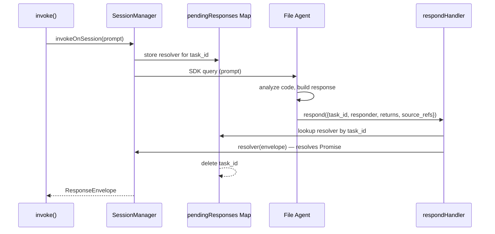
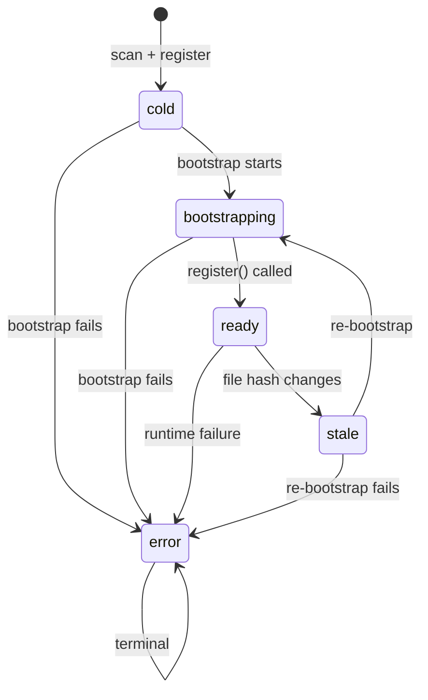

# Design Decisions and Patterns

## MCP as the Invoke Primitive

MCP tool calls are synchronous from the caller's perspective — exactly the semantics needed for distributed trace invocations. Instead of building a custom agent communication framework, eLLMulator uses MCP as the message bus and the Claude Agent SDK for session lifecycle. No custom agent framework needed.

The `invoke` tool on the internal MCP surface IS the distributed trace call. When agent A needs to call function `foo` on agent B, it calls `invoke` via MCP, which triggers `invoke()` in the server, which forwards to agent B's session. The call stack is passed explicitly, enabling cycle detection and depth limiting.

## Dependency Injection (No Globals)

Every handler factory, `invoke()`, and external MCP handler takes a `deps` object. There is zero module-level mutable state.

```typescript
// Example: invoke() signature
export async function invoke(
  envelope: InvokeEnvelope,
  deps: InvokeDeps,    // registry, sessionManager, traceLog, trackers, ...
): Promise<ResponseEnvelope>
```

Key DI types:
- **`InvokeDeps`** — registry, sessionManager, traceLog, rateLimitTracker, selfLoopTracker, readFile, projectDir, intPort, invokeContexts
- **`ServerConfig`** — projectDir, ports, verbose, model, OTEL config

Benefits:
- Testing is trivial (inject mocks)
- No implicit coupling between modules
- Server composition is explicit in `createServer()`

## Handler Factory Pattern

All handlers are created via factory functions that close over their dependencies:

```typescript
// Not classes, not middleware — just closures
export function createRegisterHandler(registry: Registry) {
  return (file_path: string, declarations: Declarations) => {
    // ... closes over registry
  };
}
```

Used throughout:
- `createRegisterHandler(registry)` → register handler
- `createStateHandlers(syntheticState)` → state_get/state_set handlers
- `createResolveHandler(registry, readFile)` → resolve handler
- `createRespondHandler(pendingResponses)` → respond handler
- `createTraceHandler(traceDeps)` → trace handler
- `createInspectHandler(queryDeps)` → inspect handler

## `type` vs `interface` Convention

| Use `type` for | Use `interface` for |
|----------------|---------------------|
| Data shapes: `InvokeEnvelope`, `TraceEntry`, `Finding` | Behavioral contracts: `Server` |
| Config: `ServerConfig`, `StartConfig` | Class definitions: `Registry`, `SessionManager` |
| Unions: `FindingType`, `CLIConfig` | |

Reasoning: types are structural (what shape does data have?), interfaces are contractual (what behavior must an implementation provide?).

## Promise-Based Response Capture

The core innovation bridging async MCP tool calls with synchronous invoke semantics:



1. `invoke()` calls `sessionManager.invokeOnSession(prompt)`
2. `invokeOnSession()` creates a `Promise<ResponseEnvelope>` and stores the resolver in `pendingResponses` (keyed by `task_id`)
3. The agent receives the prompt via SDK, analyzes the code, builds a response
4. The agent calls `respond()` via MCP with a `ResponseEnvelope`
5. `respondHandler` validates the envelope, looks up the resolver by `task_id`, calls it
6. The Promise resolves, `invokeOnSession()` returns the envelope to `invoke()`

This avoids custom event emitters or polling — clean async handoff.

## Session Lifecycle and Rehydration

SDK sessions are persisted to `~/.claude/projects/` on disk. eLLMulator persists `session_id` to SQLite. On server restart:

**Path 1: Rehydrate** (zero API calls)
- Read `session_id` from SQLite → register in SessionManager's in-memory Map
- Next `invokeOnSession()` uses `resume + forkSession` to continue the existing conversation

**Path 2: Create Fresh** (when `session_id` is null or rehydrate fails)
- If declarations exist: lightweight "ready" prompt (no full bootstrap)
- If no declarations: full bootstrap prompt (read file, read imports, register)

This means server restarts are nearly free — no re-bootstrapping needed for ready agents.

## Guardrails: Pure Functions + Stateful Trackers

Safety checks are separated into pure validation logic and mutable state:

**Pure functions** (stateless, deterministic):
- `checkCycle(target, callStack)` → `CYCLE_DETECTED` if target in stack
- `checkDepth(callStack, maxDepth)` → `MAX_DEPTH_EXCEEDED` if depth >= max
- `validateResponseEnvelope(envelope)` → checks task_id, responder, source_refs

**Stateful trackers** (mutable counters):
- `RateLimitTracker` → max 5 invocations per agent per task
- `SelfLoopTracker` → max 3 visits per target per trace
- `CircuitBreakerTracker` → N consecutive failures per agent (configurable threshold)

All guardrails return `{ ok: boolean; error?: string }`. Clean interface, easy to compose.

## Registry Status State Machine



Valid transitions are enforced at the `Registry.update()` level:

```typescript
const VALID_TRANSITIONS = {
  cold:          new Set(['bootstrapping', 'error']),
  bootstrapping: new Set(['ready', 'error']),
  ready:         new Set(['stale', 'error']),
  stale:         new Set(['bootstrapping', 'error']),
  error:         new Set(['error']),  // terminal
};
```

**Hash change side effect:** When a `ready` entry is updated with a new `file_hash`, the Registry automatically transitions to `stale` and clears `declarations` + `session_id`. No explicit staleness checks needed elsewhere.

## Starmap Clustering

The dependency graph uses Tarjan's SCC (Strongly Connected Components) algorithm to identify mutual-dependency groups, plus Union-Find for singleton absorption into target SCCs.

- **Pre-bootstrap:** Built from raw edges via `extractImports()` (static analysis)
- **Post-bootstrap:** Built from registry declarations (richer, agent-analyzed)
- **Cross-boundary edges:** Connections between different clusters
- **Used for:** Boundary-aware routing in invoke prompts, entry point detection

## OTEL Integration Philosophy

- **Fire-and-forget:** Server starts even if OTEL init fails. Export errors are logged but never propagate.
- **`SimpleSpanProcessor`** (not batch) — traces are exported immediately, not accumulated.
- **Span hierarchy:** Derived from `call_stack`, not explicit parent IDs. Each TraceEntry becomes a `ReadableSpan` with parent-child relationships reconstructed from the call stack.
- **Error isolation:** OTEL failures never affect server operation. The exporter is created in a try/catch block; if it fails, the server runs without telemetry.

## See Also

- [Architecture](architecture.md) — how these patterns compose in the server
- [Contributing](contributing.md) — how to follow these patterns when adding code
