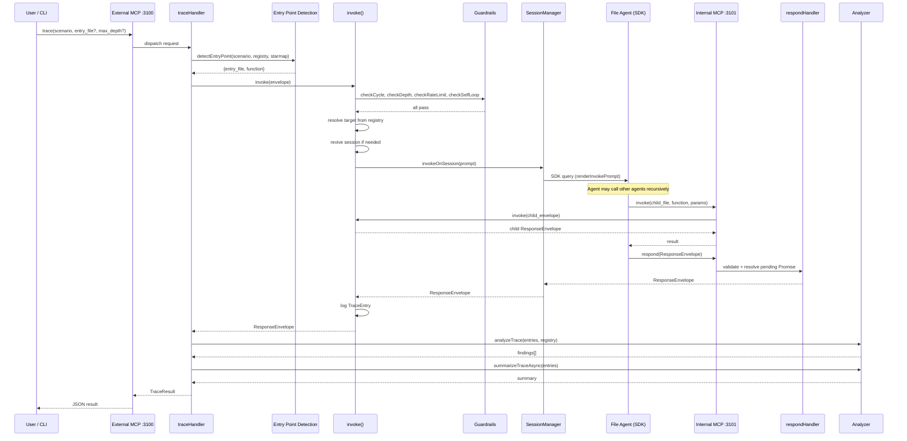
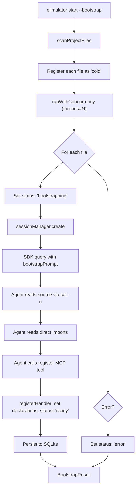
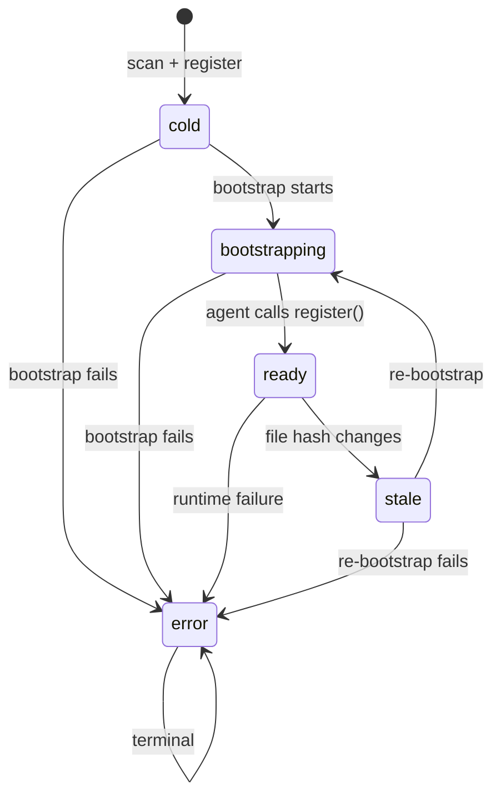
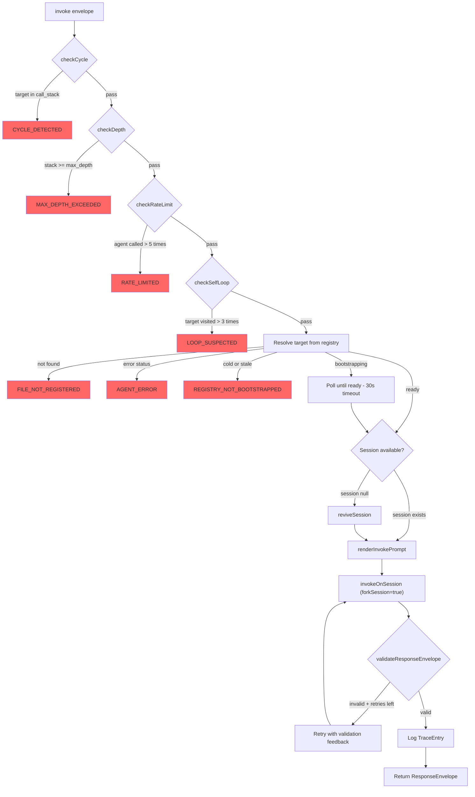
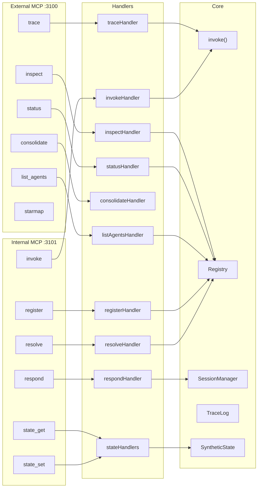
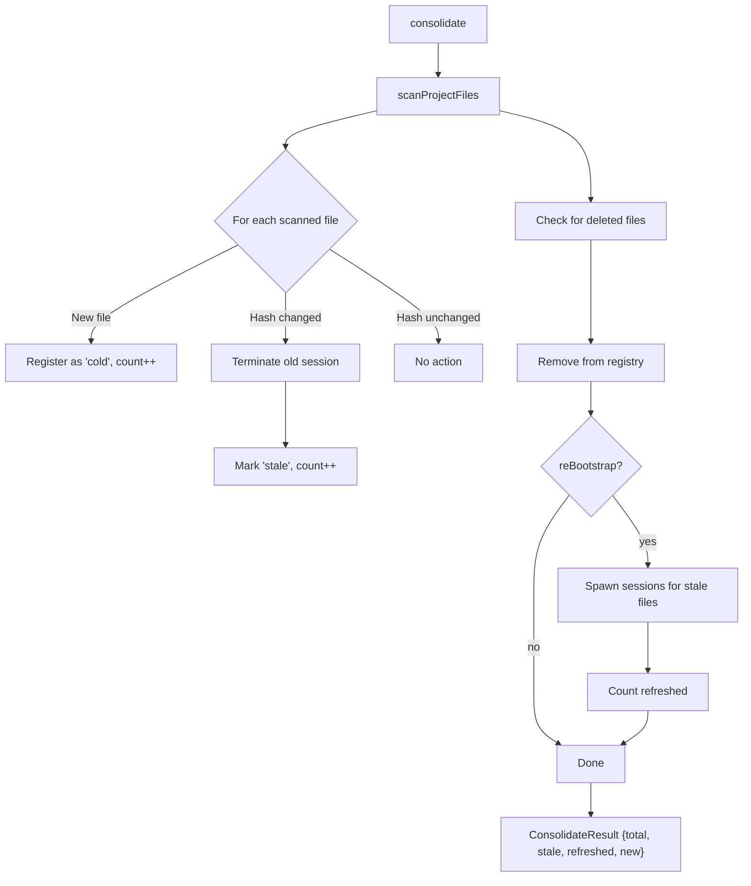
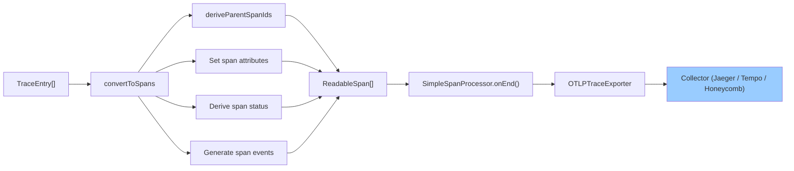
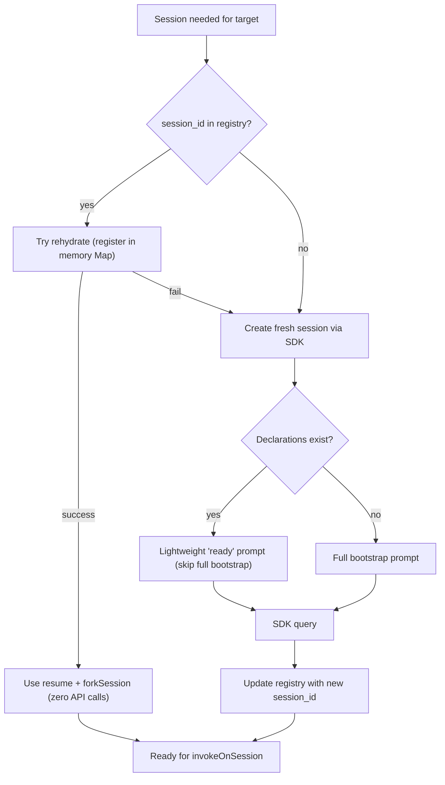

# Data Flow and Lifecycle Diagrams

## 1. Trace Flow (End-to-End)

A user calls `trace` via the external MCP surface. The server detects the entry point, builds an invoke envelope, and kicks off a recursive agent call chain.

## 2. Bootstrap Flow

Bootstrap scans project files, registers them as cold, then concurrently spawns agent sessions that read their source and register declarations.

**Bounded concurrency:** Default 10 threads. Adjust via `--threads` based on API rate limits.

**Incremental bootstrap:** Already-ready files with matching hash are skipped (unless `--force`).

## 3. Agent Lifecycle (Status State Machine)

Key transitions:
- **cold → bootstrapping:** Triggered when bootstrap starts spawning the agent
- **bootstrapping → ready:** Triggered when the agent calls `register` with its declarations
- **ready → stale:** Automatic side effect when `Registry.update()` detects a hash change
- **Any → error:** Terminal state on failure

## 4. Invoke Chain (Single Call)

Every invocation passes through this pipeline of guardrails before reaching the target agent.

## 5. MCP Tool Routing

## 6. Consolidation Flow

Consolidation rescans the project to detect file changes, marks stale entries, and optionally re-bootstraps.

## 7. OTEL Export Pipeline

Trace entries are converted to OpenTelemetry spans and exported to a collector. The pipeline is fire-and-forget — errors never affect the server.

Span hierarchy is derived from `call_stack` — each entry's parent is identified by matching the last element of its call stack to another entry's target.

## 8. Session Revival Decision Tree

When `invoke()` needs a session for a target agent, it follows this decision tree:

**Rehydrate** = register existing session_id in the in-memory Map without API calls. The SDK transcript on disk (`~/.claude/projects/`) allows `resume + forkSession` to continue the conversation.

**Create fresh** = spawn a new SDK session. If the agent already has declarations (from a previous bootstrap), use a lightweight prompt instead of re-reading the entire file.

## See Also

- [Architecture](architecture.md) — module structure and composition
- [Tool Reference](tool-reference.md) — MCP tool schemas
- [Operations](operations.md) — how to trigger these flows
