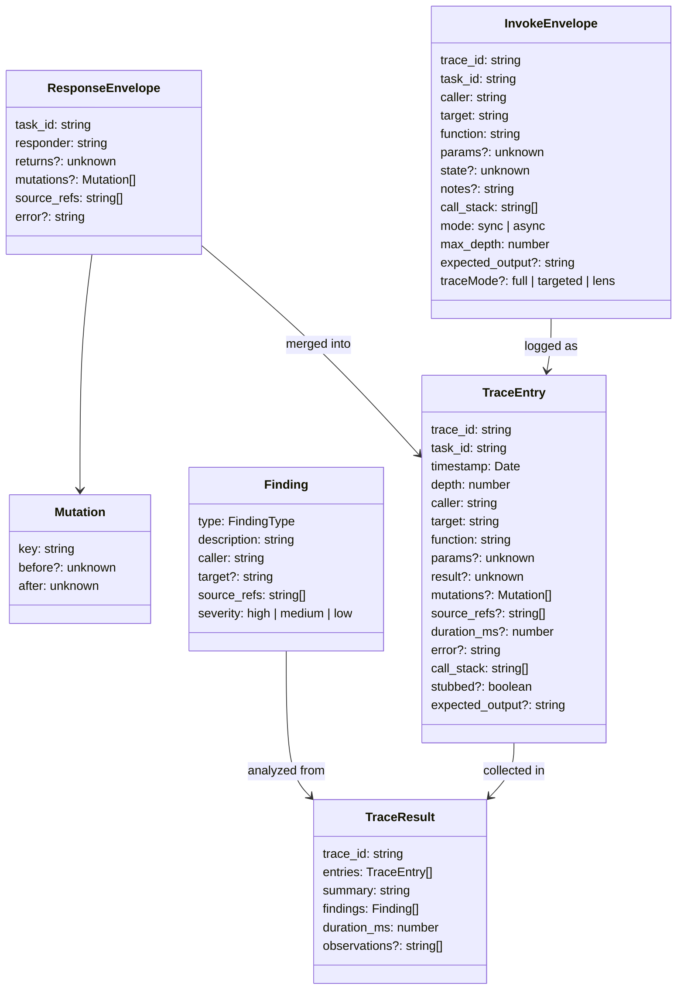

# Core Type System

All shared types live in `src/types.ts` (canonical) with Zod validation schemas in `src/schemas.ts`.

**Convention:** `type` for data shapes, `interface` for behavioral contracts.

## Type Hierarchy



## Data Shape Types

### InvokeEnvelope

The request payload for inter-agent invocation. Built by the trace handler or by agents calling `invoke`.

| Field | Type | Description |
|-------|------|-------------|
| `trace_id` | `string` | UUID identifying the trace run |
| `task_id` | `string` | UUID identifying this specific invocation |
| `caller` | `string` | File path of the calling agent (`__trace_initiator__` for root) |
| `target` | `string` | File path of the target agent |
| `function` | `string` | Function/method name to invoke on target |
| `params` | `unknown?` | Parameters passed to the function |
| `state` | `unknown?` | Synthetic state snapshot |
| `notes` | `string?` | Free-form context from caller |
| `call_stack` | `string[]` | Ordered list of callers in the chain (for cycle detection) |
| `mode` | `'sync' \| 'async'` | Invocation mode |
| `max_depth` | `number` | Maximum call stack depth (default: 50) |
| `expected_output` | `string?` | Caller's expectation of return shape (for assumption bug detection) |
| `traceMode` | `'full' \| 'targeted' \| 'lens'?` | Trace execution mode |

### ResponseEnvelope

What agents return via the `respond` MCP tool.

| Field | Type | Description |
|-------|------|-------------|
| `task_id` | `string` | Must match the InvokeEnvelope's task_id |
| `responder` | `string` | File path of the responding agent |
| `returns` | `unknown?` | Return value (structured `TraceReturn` preferred) |
| `mutations` | `Mutation[]?` | State changes observed |
| `source_refs` | `string[]` | **Required, non-empty.** Source line references (e.g., `"src/foo.ts:42-58"`) |
| `error` | `string?` | Error code if invocation failed |

### Mutation

A state change observed during function execution.

| Field | Type | Description |
|-------|------|-------------|
| `key` | `string` | State key that changed |
| `before` | `unknown?` | Value before the change |
| `after` | `unknown` | Value after the change |

### TraceEntry

A single logged invocation in the trace. Created by `invoke()` after receiving a response.

| Field | Type | Description |
|-------|------|-------------|
| `trace_id` | `string` | Trace run identifier |
| `task_id` | `string` | Invocation identifier |
| `timestamp` | `Date` | When the invocation started |
| `depth` | `number` | Call stack depth (0 = root) |
| `caller` | `string` | Calling agent file path |
| `target` | `string` | Target agent file path |
| `function` | `string` | Function invoked |
| `params` | `unknown?` | Parameters passed |
| `result` | `unknown?` | Return value from response |
| `mutations` | `Mutation[]?` | State changes from response |
| `source_refs` | `string[]?` | Source references from response |
| `duration_ms` | `number?` | Wall-clock time for invocation |
| `error` | `string?` | Error code if invocation failed |
| `call_stack` | `string[]` | Full call stack at invocation time |
| `stubbed` | `boolean?` | True if call was stubbed in lens mode |
| `expected_output` | `string?` | Caller's expectation (for assumption bug detection) |

### Declaration

A code element registered by an agent during bootstrap.

| Field | Type | Description |
|-------|------|-------------|
| `name` | `string` | Symbol name |
| `kind` | `enum` | `class`, `method`, `function`, `type`, `struct`, `interface`, `const`, `schema`, `enum` |
| `intent` | `string` | Natural language description of purpose |
| `file_path` | `string` | File containing the declaration |
| `start_line` | `number` | First line (1-based) |
| `end_line` | `number` | Last line (1-based) |
| `params` | `Array<{name, type}>?` | Parameters (for function/method kinds) |
| `return_type` | `string?` | Return type signature |

Note: `content` is not stored — the server derives it from `file_path + start_line:end_line` on demand via the `resolve` handler.

### DependencyRef

An import/dependency relationship declared by an agent.

| Field | Type | Description |
|-------|------|-------------|
| `name` | `string` | Imported symbol name |
| `from` | `string` | Source module path |
| `kind` | `enum` | `import`, `uses`, `reuses`, `inherits` |
| `file_path` | `string` | Resolved canonical file path |

### Declarations

A file's complete public API, registered during bootstrap.

| Field | Type | Description |
|-------|------|-------------|
| `summary` | `string` | Natural language summary of the file |
| `owns` | `Declaration[]` | Declarations defined in this file |
| `imports` | `DependencyRef[]` | Dependencies imported |
| `exports` | `Declaration[]` | Declarations exported |
| `dependencies` | `string[]` | File paths this file depends on |

### RegistryEntry

Agent state in the registry.

| Field | Type | Description |
|-------|------|-------------|
| `file_path` | `string` | Canonical project-relative path |
| `session_id` | `string?` | SDK session ID (undefined when cold) |
| `file_hash` | `string` | SHA256 of file content |
| `status` | `enum` | `cold`, `bootstrapping`, `ready`, `stale`, `error` |
| `declarations` | `Declarations?` | Undefined until agent registers |
| `last_active` | `Date?` | Last activity timestamp |
| `error` | `string?` | Last error message (when status=error) |

### Finding

A quality issue detected by post-trace analysis.

| Field | Type | Description |
|-------|------|-------------|
| `type` | `FindingType` | `contract_mismatch`, `assumption_bug`, `missing_error_path`, `dead_spot`, `unexpected_call` |
| `description` | `string` | Human-readable description |
| `caller` | `string` | File that triggered the finding |
| `target` | `string?` | Target file involved |
| `source_refs` | `string[]` | Relevant source references |
| `severity` | `enum` | `high`, `medium`, `low` |

### TraceRequest

User input for starting a trace.

| Field | Type | Description |
|-------|------|-------------|
| `scenario` | `string` | Natural language scenario description |
| `entry_point` | `string?` | Explicit entry file (auto-detected if omitted) |
| `state` | `Record<string, unknown>?` | Initial synthetic state |
| `max_depth` | `number?` | Max call stack depth (default: 50) |
| `stream` | `boolean?` | Enable streaming progress |
| `mode` | `enum?` | `full`, `targeted`, `lens` |
| `targetPath` | `string[]?` | Files to trace in targeted mode |

### TraceResult

Output of a completed trace.

| Field | Type | Description |
|-------|------|-------------|
| `trace_id` | `string` | Trace run identifier |
| `entries` | `TraceEntry[]` | All logged invocations |
| `summary` | `string` | Human-readable summary (LLM-generated or template) |
| `findings` | `Finding[]` | Quality issues detected |
| `duration_ms` | `number` | Total trace wall-clock time |
| `observations` | `string[]?` | Freeform architectural observations |

### ConsolidateResult

Output of a consolidation run.

| Field | Type | Description |
|-------|------|-------------|
| `total` | `number` | Total files in project |
| `stale` | `number` | Files with hash changes |
| `refreshed` | `number` | Stale files re-bootstrapped |
| `new` | `number` | New files discovered |

### TraceProspectus

Exploration agent output for trace planning.

| Field | Type | Description |
|-------|------|-------------|
| `entry_points` | `Array<{file_path, confidence, reason}>` | Candidate entry points |
| `trace_targets` | `string[]` | Files to include |
| `trace_strategy` | `string` | Recommended approach |
| `observations` | `string[]` | Preliminary observations |

## Behavioral Interfaces

### Server (`src/server.ts`)

```typescript
interface Server {
  start(): Promise<void>;
  stop(): Promise<void>;
  getRegistry(): Registry;
  getSessionManager(): SessionManager;
  getHandlers(): ServerHandlers;
  getPersistence(): PersistenceLayer | null;
}
```

### Registry (`src/registry.ts`)

```typescript
class Registry {
  add(entry: RegistryEntry): void;
  get(filePath: string): RegistryEntry | undefined;
  update(filePath: string, updates: Partial<RegistryEntry>): void;
  remove(filePath: string): void;
  list(): RegistryEntry[];
  listByStatus(status: RegistryStatus): RegistryEntry[];
  getGroup(groupId: string): RegistryEntry[];
}
```

## Dependency Injection Types

These types define the `deps` objects used by handler factories and core functions:

| Type | Used by | Key fields |
|------|---------|------------|
| `InvokeDeps` | `invoke()` | registry, sessionManager, traceLog, rateLimitTracker, selfLoopTracker, readFile, projectDir, intPort, invokeContexts |
| `ServerConfig` | `createServer()` | projectDir, extPort, intPort, verbose, model, otelEndpoint, otelProtocol, otelEnabled |
| `ServerHandlers` | server internal wiring | invoke, register, state_get, state_set, resolve, respond, trace, inspect, status, listAgents, consolidate |

## Schema Validation

Zod schemas in `src/schemas.ts` validate all MCP tool inputs at runtime:

- **Core schemas:** `InvokeEnvelopeSchema`, `ResponseEnvelopeSchema`, `DeclarationSchema`, `DependencyRefSchema`, `DeclarationsSchema`, `MutationSchema`, `TraceReturnSchema`
- **External MCP inputs:** `TraceInputSchema`, `InspectInputSchema`, `StatusInputSchema`, `ListAgentsInputSchema`, `ConsolidateInputSchema`, `StarmapInputSchema`
- **Internal MCP inputs:** `AgentInvokeInputSchema`, `RegisterInputSchema`, `StateGetInputSchema`, `StateSetInputSchema`, `ResolveInputSchema`, `RespondInputSchema`

Key validation rules:
- `ResponseEnvelopeSchema.source_refs`: `z.array(z.string()).min(1)` — agents must cite source lines
- `DeclarationSchema.start_line/end_line`: `z.number().int().positive()` — 1-based line numbers
- `TraceInputSchema.scenario`: optional (entry_file + function can substitute)

## See Also

- [Architecture](architecture.md) — where types live in the module graph
- [Design Decisions](design-decisions.md) — `type` vs `interface` rationale
